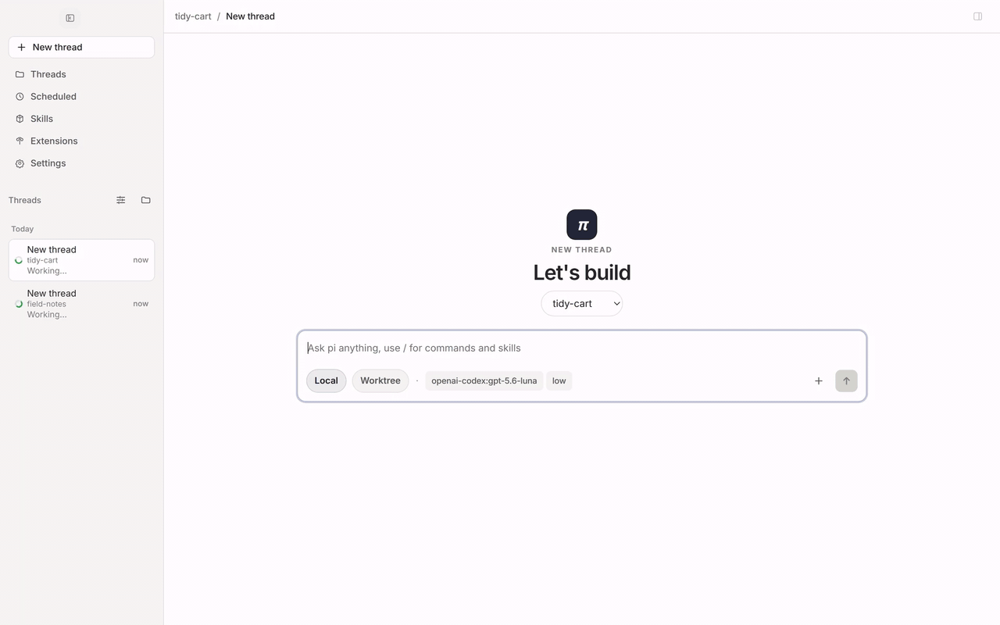
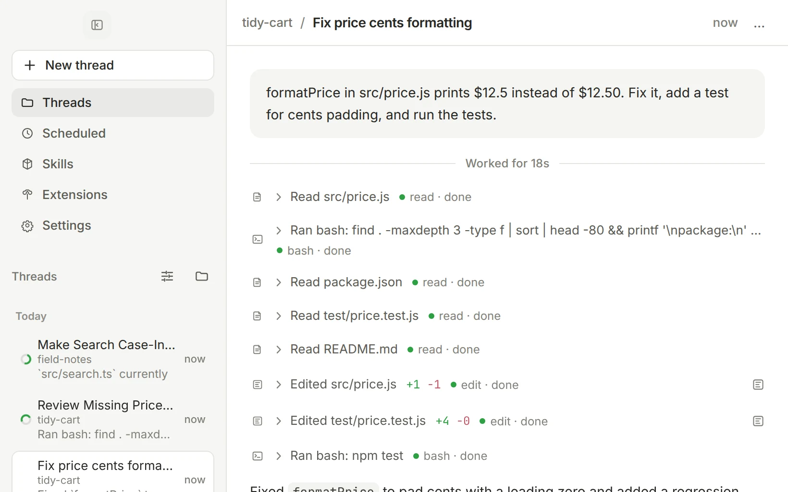
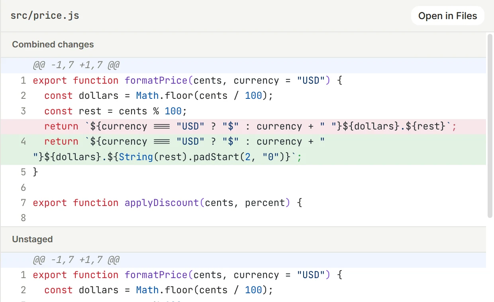
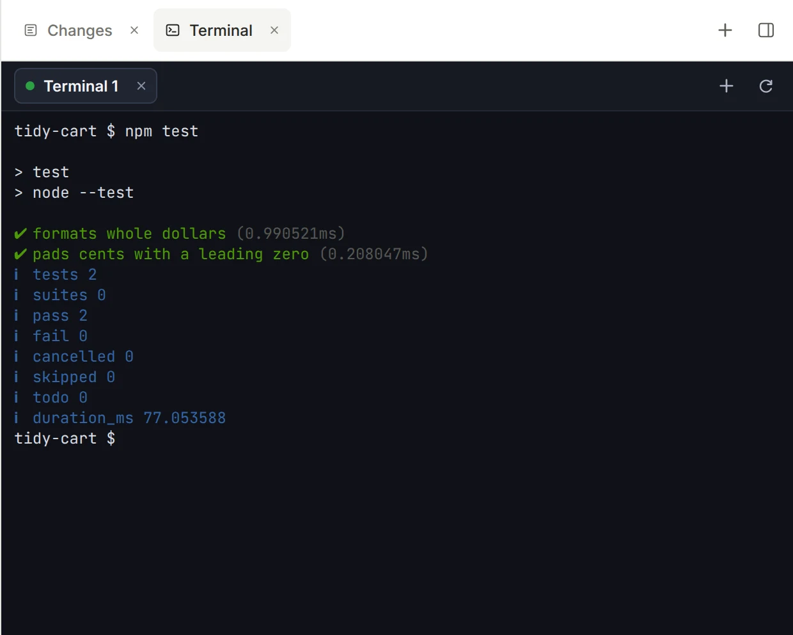
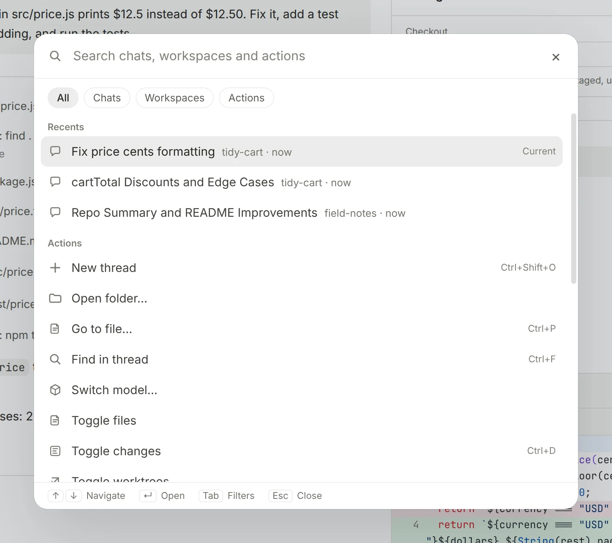

# pi-gui

[English](./README.md) · [简体中文](./README.zh-CN.md)

[pi](https://github.com/earendil-works/pi) 编码 agent 的桌面应用。

[](./LICENSE)
[](https://github.com/minghinmatthewlam/pi-gui/releases)
[](#安装)

并行运行多个 agent 会话，需要时每个会话都有自己的 git 工作树。审查每一处改动，在真实终端里跑测试，不离开窗口就能交付。pi-gui 是
[`@earendil-works/pi-coding-agent`](https://www.npmjs.com/package/@earendil-works/pi-coding-agent)
的桌面外壳，而不是另一个 agent：会话、模型、认证与工具全部经由 pi 本身运行，你在 pi CLI 里配置好的一切都会沿用。

[](./apps/website/public/media/hero.mp4)

<sub>一次真实运行：agent 修复 bug、补上测试并运行，然后把改动打开供审查。（[观看高清版](./apps/website/public/media/hero.mp4)）</sub>

## 功能

### 并行运行 agent

每个任务都有自己的会话。可以在当前检出里启动，也可以在全新的 git 工作树里启动，然后在这个还在跑的时候开始下一个。侧栏
会显示哪些正在运行、哪些已完成、哪些需要你处理。你可以置顶会话、按时间或工作区分组，并把做完的归档。



### 每次改动都先审查再落地

「审查」标签页精确显示 agent 动过哪些内容。可以比较未提交的改动、某个分支与其基线的差异，或单个回合的改动，并按文件逐个
暂存或取消暂存。

<picture>
  <source media="(prefers-color-scheme: dark)" srcset="./apps/website/public/media/review-dark.webp">
  
</picture>

### 终端与文件在同一个窗口

会话旁边的工作台里有真实终端、文件浏览器与编辑器、审查标签页、你的工作树，以及桌面扩展提供的标签页。每个任务保留自己的
布局。

<picture>
  <source media="(prefers-color-scheme: dark)" srcset="./apps/website/public/media/terminal-dark.webp">
  
</picture>

### 一切都在一次按键之内

<picture>
  <source media="(prefers-color-scheme: dark)" srcset="./apps/website/public/media/palette-dark.webp">
  
</picture>

| 快捷键（macOS；Linux 与 Windows 用 Ctrl） | 作用                     |
| ----------------------------------------- | ------------------------ |
| <kbd>⌘</kbd> <kbd>K</kbd>                 | 搜索会话、工作区与操作   |
| <kbd>⌘</kbd> <kbd>P</kbd>                 | 打开当前检出中的任意文件 |
| <kbd>Ctrl</kbd> <kbd>Tab</kbd>            | 在最近的会话之间切换     |
| <kbd>⌘</kbd> <kbd>1</kbd> 到 <kbd>9</kbd> | 跳到侧栏中的第 N 个会话  |
| <kbd>⌘</kbd> <kbd>J</kbd>                 | 显示或隐藏终端           |
| <kbd>⌘</kbd> <kbd>R</kbd>                 | 显示或隐藏审查标签页     |
| <kbd>⌘</kbd> <kbd>⌥</kbd> <kbd>B</kbd>    | 显示或隐藏工作台         |
| 运行中按 <kbd>Enter</kbd>                 | 追加一条后续消息         |
| 运行中按 <kbd>⌘</kbd> <kbd>Enter</kbd>    | 干预当前这次运行         |

### 还有这些

- **计划任务。** 让 pi 按计划重跑某条提示词，比如每周的依赖检查，应用打开期间即可执行。
- **技能与扩展。** 随时开关 pi 的技能与扩展，在输入框里试用，并让桌面扩展拥有自己的工作台标签页。
- **任意提供方。** 用 OAuth 登录、粘贴 API 密钥，或指向自定义端点。按会话选择模型与思考等级。
- **派生与回溯。** 从任意一条消息把会话派生到同一个检出或新的工作树，并用 `/tree` 在会话树中移动。
- **输入框。** 用 `@` 提及文件，把图片粘贴或拖进提示词。
- **会话也能启动会话。** agent 可以启动、读取并向其他会话发消息，这些会话会像普通会话一样出现在侧栏。
- **通知。** 后台会话完成、失败或需要你时收到提醒。
- **主题。** 亮色与暗色，另有 Catppuccin、Tokyo Night、Nord、Dracula、Gruvbox 和 GitHub 等预设。

## 安装

pi-gui 支持 macOS（Apple Silicon）、Linux（x64）与 Windows（x64）。

从 [Releases 页面](https://github.com/minghinmatthewlam/pi-gui/releases) 下载最新的 `.dmg`（macOS）、
`.AppImage` 或 `.deb`（Linux）、`.exe`（Windows）。

- **macOS：** 把 `pi-gui.app` 拖进「应用程序」。发布版本已签名并公证。
- **Linux：** 给 AppImage 加上可执行权限后直接运行，或安装 `.deb`。
- **Windows：** 运行安装版 `.exe`，或使用便携版 `.exe`。目前构建尚未代码签名，SmartScreen 可能会要求你确认。

macOS 上也可以用 Homebrew：

```bash
brew tap minghinmatthewlam/tap
brew install --cask pi-gui
```

用 `brew upgrade --cask pi-gui` 更新。Homebrew 升级时可能会要求你重新确认 macOS 权限或 Dock 位置。其他安装方式会在有新版本
时提示你，并从 Releases 页面更新。

从源码构建面向贡献者；见[开发](#开发)。

## 快速开始

1. 安装 pi-gui 并打开。
2. 打开 **设置 → 提供方**，连接一个模型提供方（OAuth 或 API 密钥）。
3. 添加工作区：一个本地项目文件夹。
4. 点击 **新会话**，选择 **本地** 或 **工作树**，然后发出第一条提示词。

pi-gui 读写 pi 自己的会话文件与设置，因此会话、凭据与技能都与 pi CLI 共享。

## 架构

pi-gui 是一个 Electron 应用，在 pi 运行时之上保持主进程、预加载与渲染进程之间严格的边界：

- **渲染进程**（`apps/desktop/src`）：React UI，包含时间线、输入框、工作台与设置。它只通过带类型的 IPC 接口与主进程通信。
- **预加载**（`apps/desktop/electron/preload.ts`）：暴露该 IPC 接口的窄桥。渲染进程拿不到宽泛的 Node 能力。
- **主进程**（`apps/desktop/electron`）：窗口、会话监管、工作树、终端 PTY、计划任务、通知与持久化。
- **`packages/pi-sdk-driver`**：`@earendil-works/pi-coding-agent` 之上的薄适配层，紧贴上游 pi，不 fork、也不重写运行时行为。
- **会话文件是唯一真相。** pi 把每个会话以 JSONL 记录存在磁盘上，pi-gui 直接读这些文件，而不维护自己的副本。

所有权与边界见 [docs/architecture.md](docs/architecture.md)。

## 开发

需要 Node 22.19 或更高版本（CI 用 Node 22），以及通过 `corepack` 启用的 [pnpm](https://pnpm.io)。
`pnpm-lock.yaml` 是权威锁文件。

```bash
corepack enable
pnpm install
```

仓库根目录下的常用命令：

```bash
pnpm dev            # 以热重载方式运行桌面应用
pnpm check          # CI 基线：格式、lint、渲染进程边界、类型、守卫与驱动测试
pnpm build          # 构建桌面应用与官网
pnpm typecheck      # 对所有工作区做类型检查
pnpm lint           # 正确性规则，外加带类型的 promise 与 unsafe-any 检查
pnpm format         # 应用统一的格式化
pnpm test           # 各工作区的测试（桌面端跑 core 泳道）
pnpm marketing:media  # 用一次真实 agent 运行重新录制 README 与官网的素材
```

`pnpm check` 是本地与 CI 共用的基线。它不启动 Electron，也不替代 desktop、website-build 与打包那几个 CI job；见
[docs/ci-baseline.md](docs/ci-baseline.md)。

桌面端端到端测试用 Playwright 驱动真实的 Electron 应用，并按泳道划分。`pnpm test` 跑 `core` 泳道；要跑全部：

```bash
pnpm --filter @pi-gui/desktop run test:e2e:all   # core + live + native
```

各泳道、各平台的打包方式，以及产品素材如何录制，见
[`apps/desktop/README.md`](./apps/desktop/README.md)。

## 仓库结构

- `apps/desktop`：Electron 应用（渲染进程、主进程与预加载）。
- `apps/website`：[pi-gui.com](https://www.pi-gui.com)。
- `packages/pi-sdk-driver`：`@earendil-works/pi-coding-agent` 的适配层。
- `packages/session-driver`：共享的会话驱动类型。
- `packages/catalogs`：工作区与会话目录状态。
- `packages/extension-ui`：构建桌面扩展视图的辅助库。
- `examples/desktop-extensions`：示例扩展，各自带工作台标签页。
- `video`：Remotion 宣传视频。
- `docs`：架构、CI 与设计说明。
- `.agents/skills`：入库的 agent 技能，含桌面验证。

## 贡献

欢迎贡献。安装方式、验证要求与桌面测试泳道见 [CONTRIBUTING.md](./CONTRIBUTING.md)。桌面改动应在真实 Electron 应用上验证，
而不只是单元测试。

## 本机操作

pi-gui 不内置原生「computer use」。桌面与浏览器控制通过独立的
[`computer-use-mcp`](https://github.com/minghinmatthewlam/computer-use-mcp) 服务单独提供，任何支持 MCP 的 agent 都可以
使用。

## 致谢

构建于 [`@earendil-works/pi-coding-agent`](https://www.npmjs.com/package/@earendil-works/pi-coding-agent)
与 [pi](https://github.com/earendil-works/pi) 运行时及其生态之上。

## 许可证

[MIT](./LICENSE) © Matthew Lam
